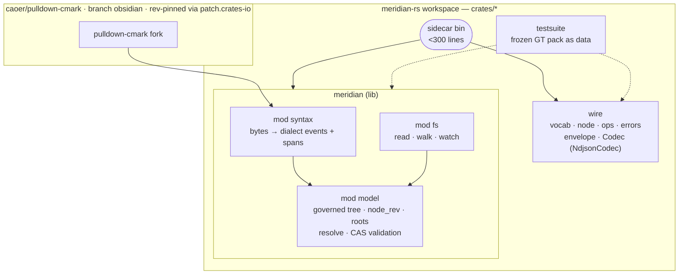

# meridian-rs — `candidate/collapse-first`

Skeleton-workspace candidate for the meridian-rs crate architecture. Rival:
`candidate/laws-as-crates`. Binding vision (three laws, capability ladder, wire):
`field-notes-sessions/year=2026/month=07/16-17-ccc-session-md-as-file-system/results/meridian-rs-vision.md`.
Wire contract: `18-02-meridian-rs/results/wire-contract-v1.md` (proto 1, revision round 1).

## Thesis

Crate boundaries are cost, not virtue: every boundary taxes compile time, forces
lockstep edits while the wire contract is still revising, and — worst — freezes a
*name and a split* at the moment we know least. Tokio paid to undo exactly this
(RFC 1318: 43 crates → 13, hello-world build 50 s → 13 s); cargo ships a monolithic
lib whose doctrine — "each command is a thin wrapper around ops" — this workspace
transposes to "each wire op is a thin wrapper around a lib call." So: **four members,
no more.** `meridian` is the world model as one lib whose internal modules carry, in
module-level charters, the same laws the rival expresses as crate walls; `wire` is the
single Go-visible surface with framing as a swappable `Codec` impl rather than a crate;
`sidecar` is a <300-line bin; `testsuite` is one consolidated test binary holding the
frozen GT pack as data. A boundary is added only when it is *earned* — a second
consumer, an invariant that must be unbreakable by construction, or a distinct
stability contract (the research doc's three criteria) — and every foreseeable earning
event is pre-mapped in the satellite table below, so each future split is an
extraction, not a redesign. The absence of satellites IS the thesis: wrong names and
wrong splits at the foundation are the 5-week trap, and the cheapest split is the one
you never had to rename.

## Members and charters

| Member | Charter (one line) |
|---|---|
| `crates/meridian` (lib) | The markdown world model as one lib — dialect syntax, governed node tree, and disk truth as internal modules; every op the sidecar answers is a call into this curated surface |
| · `mod syntax` | One pure function: markdown bytes → dialect event list with byte-exact spans (fork events + `%%comment%%`/mask post-passes) — never I/O, state, or hashing |
| · `mod model` | The in-memory world model: governed node tree (kind/span/node_rev/hpath), Merkle roots, `resolve`, CAS-splice validation, node diff — never file I/O, persistence, or protocol types |
| · `mod fs` | Disk truth in: read, walk, watch; feeds the model and nothing else — never writes what it didn't splice, never caches to disk |
| `crates/wire` | The only Go-visible surface: wire-contract-v1 vocabulary, node schema, op/req/resp/error types, `Message` envelope, and the `Codec` framing seam — all in one crate |
| `crates/sidecar` (bin, v0.1.0) | Thin NDJSON stdin/stdout bin over `meridian` + `wire`: arg parsing and transport wiring only — anything a lib could own, a lib owns |
| `crates/testsuite` | Consolidated integration-test member (one test binary): the frozen GT pack as data, wire-level golden pairs, cross-crate tests |

Every charter above and in the crate/module docs fits one line — the quality gate held;
no two-line charters were fudged.

`meridian` and `wire` are deliberate siblings: the lib never sees protocol types
(law 3 kept by dependency direction, the one boundary this candidate does buy), and
the sidecar owns the model→wire mapping at its seam.

## The three laws (binding on every member)

1. **Rust is the world model, Go is the actor.** This workspace answers what the
   files say, what changed, what's valid; Go decides who does what about it. Rust
   never talks to an agent; Go never parses markdown.
2. **Truth geography.** Disk = markdown, the only durable truth; Rust memory is
   derived and disposable. No snapshot files, no cache files, no database — cold
   rebuild (2.16 s measured) is the recovery path by construction.
3. **One-way arrows.** files → Rust → Go; recovery at every layer is re-derive from
   the layer below. Events are a latency optimization, never a correctness dependency.

## Axis positions

- **A (granularity): coarse.** The candidate axis — this whole branch is the answer.
- **B (fork consumption): shared resolution, Zed mode.** `[patch.crates-io]` + rev pin
  at the workspace root (one copy graph-wide for a common transitive dep); fork
  version tracks upstream's (0.13.1 today); merge-from-upstream on `obsidian`; each
  rev bump commented with its upstream PR. Pin `bc5df96c` verified building.
- **C (wire evolution): one wire crate with a codec seam.** Types + envelope + framing
  in one crate; the §5 graduation test ("NDJSON → JSON-RPC touches one crate") is
  satisfied by a **second `Codec` impl in the same crate**, consumers untouched — an
  impl swap, not a crate split. Nushell's Hello preamble is the production proof of
  the handshake shape; rust-analyzer's lsp-server proves the swappable seam pays.
- **D (versioning): shared resolution.** `resolver = "2"`, `[workspace.package]`
  `publish = false`, internals `0.0.0`, `{path, version = "0.0.0"}` workspace deps,
  one real version on the sidecar bin (0.1.0).
- **E (write authorization): position (b) — authorization is Go-side; splice trusts
  pre-authorized callers.** The argument: I3 rules are hpath/section-shaped, but
  *evaluating them for a write decision requires actor identity*, and actors are fleet
  state — Go's, by law 1. The policy-schema design already drew this line (T2 ruling:
  "the oracle sees states, not who changed them" — transition/actor policy lives in
  the rung-4 change feed + Go). Splitting I3 across the wire (Rust evaluates
  section-shape, Go supplies actor) would make a *write gate* depend on two processes
  agreeing about half a rule each — the worst place for a seam. So the sidecar stays a
  pure integrity oracle: span + rev freshness (CAS) in Rust; who-may-write composes
  Go-side before the splice is sent. Consequence in the types: `SpliceReq` carries no
  actor field and never will. What Rust still gives the write path at rung 6:
  *diagnostic* evaluation of section-shaped rules (rules-as-data engine), which Go may
  consult in its authorization decision — verdicts on state, never on actors.

## Satellite map — where the absent crates land, and what earns the split

Split criteria (research §1, used verbatim): **(i)** a second consumer, **(ii)** an
invariant that must be unbreakable by construction, **(iii)** a distinct stability
contract. Size never earns a crate.

| Absent satellite | Lands first as | Splits out when |
|---|---|---|
| `policy` (rung 6 — contract: `results/policy-schema-design.md`) | `meridian::policy` module: the 14-assertion engine with declared `Budget{class, p99_us}`, ruleset compile + content-hash cache + pin verify, `policy`/`policy_compile`/`policy_vocab` ops; borrows model's corpus index as a capability parameter (`Option<&CorpusIndex>`), never owns it | (iii): the vocab-version + declared-p99 surface is a *stability contract with ruleset authors* — when `policy_vocab` ships and external rulesets pin against it, the engine has semver-like obligations the rest of the lib doesn't; that's the split day. Also (i) if the LSP daemon and sidecar diverge in what they load |
| `query` (rung 5) | `meridian::query` module: backlinks, board queries, span-exact rename planning — sibling of policy over model's index, applies nothing | (i): a consumer of corpus queries that is not the daemon (e.g. an xtask or Go-side batch tool wanting query without wire); until then it's one more module over the same borrowed index |
| `daemon` (rung 4) | A **second bin** in `crates/` — bins are thin by doctrine, and code two bins need is already in the lib by construction (deno's `denort` precedent) | Never "splits" — a bin is not a satellite. Its arrival extends `meridian::fs` (watch) and adds subscription wiring; the lib absorbs it under law 4 (additive) |
| `framing-jsonrpc` (rung 4/6) | A second `Codec` impl **inside `wire`** — the graduation claim, stated in `wire`'s crate doc | (i) only: a consumer of framing that is not this workspace's bins. No such consumer is on any rung; if one appears, the trait is already the seam |
| `vocab`/types crate (the rival's serde-only types split) | The four nouns live in `wire::vocab`; `meridian::model` carries its own `Span`/`NodeRev` (4 lines of deliberate duplication at the sibling seam) | (iii): a types-only consumer with its own release cadence — Go-side codegen or a third-party client consuming types without framing. Watch this one: it is the likeliest first split (see Findings) |
| `bench` | Nothing here — parser-bench owns the sweep (206-file corpus, adversarial pack) against the same frozen fixtures | Criterion targets existing in-repo; the fork's own `bench` member layout is the template |
| `wikiuri`/encode (B coverage map, undecided) | Stays Go until decided | If it comes Rust-side: (ii) would argue a leaf crate (zero-dep pure grammar), but as a module first, per this school |

## Relocation fit — Stream G rung-1 sidecar

The real rung-1 sidecar (`parser-bench/lanes/rust-sidecar`, contract-conforming,
golden-tested) relocates into the chosen candidate. Piece-by-piece against this
branch:

| Sidecar piece | Destination here | Fit |
|---|---|---|
| Extraction core (`lanes/rust-pulldown/src/lib.rs`: `extract()`, `Node`, span laws, `verify_spans`, 14 unit tests) | `meridian::syntax` (tests → `testsuite` + the GT harness) | **Awkward, honestly flagged:** the lane's `Node` is one type doing two jobs — parse output *and* wire payload (string kinds, `text_prefix_16b` baked in). Here it must split into `syntax::SyntaxEvent` / model tree vs `wire::Node`, plus a mapping. That seam does not exist in the lane code and must be drawn during relocation. Note this cost is candidate-independent — the rival's `syntax`/`wire` crate split forces the identical surgery — so it is evidence about the lane, not between candidates |
| Framing + ops + error envelope (`src/lib.rs`, 232 lines, one flat file: `handle_line`, envelope structs, op handlers) | Splits three ways: frame/id-echo/envelope → `wire` (`NdjsonCodec` + `envelope`); req/resp/error shapes → `wire::op`/`wire::error`; op handler *bodies* (fs read, UTF-8 refusal, span self-check) → `sidecar::handle` calling `meridian` | **Good fit, one honest inversion:** the lane never split framing from ops — it is one file — so folding both into one `wire` crate loses no boundary the code earned. The real relocation work is the *reverse* of the task's worry: teasing world-model concerns (file read, UTF-8 law) OUT of the op handlers into `meridian`. The lane's flat shape maps more naturally onto this candidate's single `wire` crate than onto the rival's types/transport split |
| `src/main.rs` (45 lines: arg parse + stdin loop) | `crates/sidecar/src/main.rs` | Clean drop-in; this skeleton's main is the same shape grown to typed dispatch |
| Golden pairs (`tests/golden/*.pairs.ndjson`, fixtures, `golden.rs`, `bin.rs`) | `testsuite` (pairs as data beside the GT pack; `bin.rs`'s debuggability tests verbatim) | Clean; pairs files are raw wire lines, shareable with the Go fixture pack unchanged |
| Lane `CAPS = ["toc","extract"]` | `sidecar` `CAPS = ["hello","toc","extract"]` | **Lane bug surfaced by relocation:** contract §5.1 requires `caps` complete *including `hello`*. Fixed here; flag back to the lane |

Net: no piece's move is blocked; one piece (extraction core) needs a type split both
candidates force; the framing fold is where this candidate is *stronger* on
relocation, not weaker.

## What this candidate risks — and why it accepts it

**The risk is law erosion at agent speed.** Module charters are prose; the compiler
does not enforce them. An agent five minutes from a green build can `use crate::model`
from `fs`, hang serde on a model type, or quietly persist a cache — precisely the
5-minute workaround the vision exists to prevent, and nothing in this workspace's
build breaks when it happens. The rival makes those moves structurally impossible;
this branch makes them merely *visible* (one-line charters in every module doc, the
laws restated in every crate README, review diffs against both).

Accepted, with eyes open, because: **(1)** the counter-risk is worse right now —
rungs 2–6 are still landing and the wire contract is mid-revision; premature crate
walls mean lockstep multi-crate churn and, if a name or split is wrong, a public
un-split (tokio's RFC 1318 was exactly that payment, 43 → 13). Law 4 (additivity —
nothing shipped gets split or renamed) makes a wrong *early* boundary the most
expensive mistake available to us, and wrong names at the foundation are the 5-week
trap. **(2)** The durable defense against law erosion was never going to be the crate
graph — it is rung 6 itself: the policy oracle gating at commit time, plus review.
This branch keeps that defense and skips the scaffolding. **(3)** Every earning event
is pre-mapped (satellite table), so discipline failures have a structural answer: the
day a module's charter is violated twice is the day criterion (ii) is proven and the
module graduates to a crate — an extraction along a drawn seam, not a redesign.

## Skeleton status

- `cargo check --workspace` / `cargo test --workspace` green (GT-pack smoke: 10
  expectation files load, spans in bounds, kinds deserialize through `wire::NodeKind`).
- Public seams are compiling stubs (`todo!()` bodies): `syntax::parse`,
  `model::{build, resolve, validate_splice}`, `fs::read_file`, `wire`'s
  `NdjsonCodec`; the sidecar's dispatch is fully written against them.
- Fork pin `bc5df96c` (branch `obsidian`, = upstream 0.13.1) resolves and builds via
  `[patch.crates-io]`; `ENABLE_OBSIDIAN_*` events are step 0, which repins.
- GT pack vendored frozen (provenance: `crates/testsuite/data/gt/FROZEN`); known
  vintage deltas vs the contract (string `hpath`, pre-underscore anchor charset) are
  documented in `testsuite`'s crate doc, not silently normalized.
